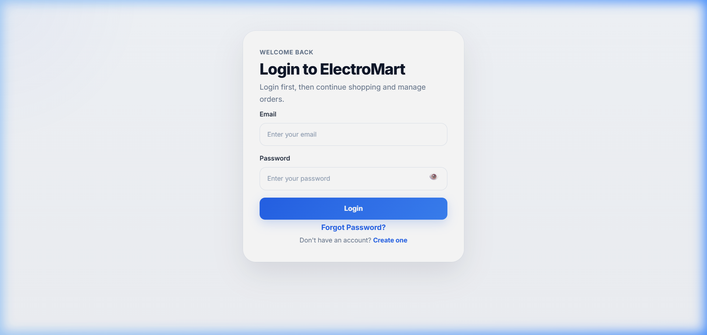
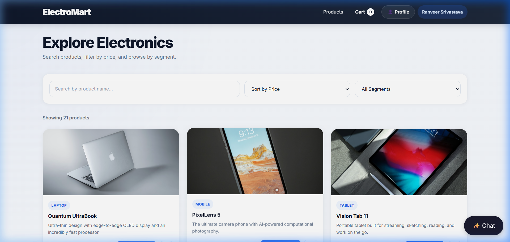
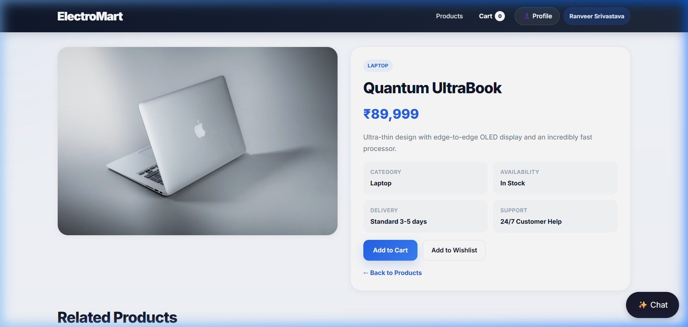
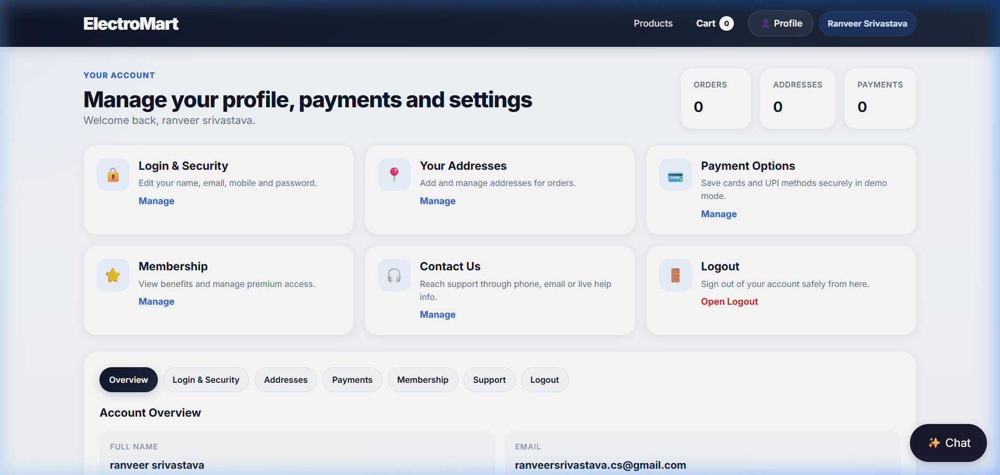

<div align="center">

# ⚡ ElectroMart — AI-Powered E-Commerce Platform

A full-stack MERN e-commerce platform with an **autonomous AI shopping assistant** powered by Llama 3.1 via the Groq API. Users can browse products, manage carts, place orders, and interact with an AI agent that can search products and add items to cart through natural conversation.

[](https://electro-mart-bawe-omega.vercel.app)
[](https://electro-mart-admin-panel.vercel.app)

</div>

---

## 📸 Screenshots

<details>
<summary><strong>Click to expand screenshots</strong></summary>

### Login Page


### Products Page


### Product Details


### User Profile & Account Management


</details>

---

## ✨ Features

### 🛒 Customer Features
- **Product Browsing** — Browse, search, and view detailed product pages with images, descriptions, and pricing
- **Shopping Cart** — Add/remove products, update quantities, and view real-time cart totals
- **Wishlist** — Save favorite products for later
- **Secure Checkout** — Cascading state → city dropdown validation, multiple payment methods (COD, UPI, Credit/Debit Card)
- **Order Management** — Track order history and order status
- **User Profile** — Multi-panel account management (Overview, Security, Addresses, Payments, Membership, Support)
- **AI Shopping Assistant** — Chat with an AI agent that can search products and add items to your cart autonomously

### 🤖 AI Shopping Agent
- Powered by **Llama 3.1** via the **Groq API**
- Uses **LLM function-calling** to execute real actions (search products, add to cart, checkout)
- Maintains conversation history per user
- Integrated directly into the shopping experience as a chat widget

### 🔐 Authentication & Security
- JWT-based authentication with **dual-mode support** (HTTP cookies + Bearer token headers)
- Email verification with OTP via **Nodemailer**
- Forgot password flow with secure reset tokens
- Role-based access control (RBAC) — Customer vs Admin
- Cross-origin mobile browser compatibility (bypasses third-party cookie restrictions)

### 🛡️ Admin Panel
- **Dashboard** — Overview of store metrics
- **User Management** — View, search, and manage registered users
- **Product Management** — Full CRUD operations (Create, Read, Update, Delete) for products
- **Order Management** — View and update order statuses

---

## 🛠️ Tech Stack

### Frontend
| Technology | Purpose |
|---|---|
| **React 19** | UI library |
| **Vite 8** | Build tool & dev server |
| **React Router v6** | Client-side routing |
| **Vanilla CSS** | Custom styling (no CSS frameworks) |
| **React Hot Toast** | Toast notifications |

### Backend
| Technology | Purpose |
|---|---|
| **Node.js** | Runtime environment |
| **Express.js** | REST API framework |
| **MongoDB + Mongoose** | Database & ODM |
| **JWT (jsonwebtoken)** | Authentication tokens |
| **Bcrypt.js** | Password hashing |
| **Nodemailer** | Transactional emails (OTP, welcome, admin alerts) |
| **Helmet + CORS** | Security headers & cross-origin support |
| **Zod** | Schema validation |
| **Morgan** | HTTP request logging |

### AI Integration
| Technology | Purpose |
|---|---|
| **Groq API** | Ultra-fast LLM inference |
| **Llama 3.1** | Language model for the shopping agent |
| **OpenAI SDK** | Function-calling interface for tool execution |

### DevOps & Deployment
| Technology | Purpose |
|---|---|
| **Vercel** | Serverless deployment (Frontend + Backend + Admin) |
| **MongoDB Atlas** | Cloud database |
| **GitHub** | Version control |

---

## 📁 Project Structure

```
ai-ecommerce-platform/
├── frontend/                # Customer-facing React SPA
│   ├── src/
│   │   ├── pages/           # Login, Signup, Products, Cart, Checkout, Profile, etc.
│   │   ├── components/      # Navbar, AIChatWidget, Footer
│   │   ├── api.js           # Centralized auth-fetch utility
│   │   └── index.css        # Global styles
│   └── public/              # Static assets (logo, icons)
│
├── backend/                 # Node.js/Express REST API
│   ├── src/
│   │   ├── controllers/     # Auth, Product, Cart, Order, AI, User controllers
│   │   ├── models/          # Mongoose schemas (User, Product, Cart, Order, ChatHistory)
│   │   ├── routes/          # API route definitions
│   │   ├── middlewares/     # JWT auth middleware
│   │   └── utils/           # Token generation, email sender
│   └── api/                 # Vercel serverless entry point
│
├── admin/                   # Admin panel (separate React SPA)
│   └── frontend/
│       └── src/pages/       # Dashboard, UserList, ProductList, OrderList, ProductEdit
│
├── ai-service-python/       # Python microservice for AI agent
└── docs/                    # Documentation & screenshots
```

---

## 🚀 Getting Started

### Prerequisites
- **Node.js** v18+
- **MongoDB** (local or [MongoDB Atlas](https://www.mongodb.com/atlas))
- **Groq API Key** ([Get one here](https://console.groq.com))

### 1. Clone the Repository
```bash
git clone https://github.com/Ranveercode/ElectroMart.git
cd ElectroMart
```

### 2. Setup Backend
```bash
cd backend
npm install
```

Create a `.env` file in `backend/`:
```env
PORT=5000
MONGO_URI=your_mongodb_connection_string
JWT_ACCESS_SECRET=your_jwt_secret
JWT_REFRESH_SECRET=your_jwt_refresh_secret
GROQ_API_KEY=your_groq_api_key
EMAIL_SERVICE=gmail
EMAIL_USER=your_email@gmail.com
EMAIL_PASS=your_app_password
CLIENT_URL=http://localhost:5173
ADMIN_URL=http://localhost:5174
```

Start the backend:
```bash
npm run dev
```

### 3. Setup Frontend
```bash
cd ../frontend
npm install
npm run dev
```

### 4. Setup Admin Panel
```bash
cd ../admin/frontend
npm install
npm run dev
```

---

## 🌐 API Endpoints

| Method | Endpoint | Description | Auth |
|--------|----------|-------------|------|
| POST | `/api/auth/signup` | Register new user | ❌ |
| POST | `/api/auth/verify` | Verify OTP | ❌ |
| POST | `/api/auth/login` | Login | ❌ |
| POST | `/api/auth/logout` | Logout | ✅ |
| POST | `/api/auth/forgot-password` | Request password reset | ❌ |
| POST | `/api/auth/reset-password` | Reset password | ❌ |
| GET | `/api/products` | Get all products | ❌ |
| GET | `/api/products/:id` | Get product by ID | ❌ |
| POST | `/api/products` | Create product (Admin) | ✅ |
| PUT | `/api/products/:id` | Update product (Admin) | ✅ |
| DELETE | `/api/products/:id` | Delete product (Admin) | ✅ |
| GET | `/api/cart` | Get user's cart | ✅ |
| POST | `/api/cart` | Add to cart | ✅ |
| DELETE | `/api/cart/:id` | Remove from cart | ✅ |
| DELETE | `/api/cart/clear` | Clear entire cart | ✅ |
| POST | `/api/orders` | Place order | ✅ |
| GET | `/api/orders` | Get user's orders | ✅ |
| POST | `/api/ai/chat` | AI assistant chat | ✅ |
| GET | `/api/ai/history` | Get chat history | ✅ |

---

## 🧑‍💻 Author

**Ranveer Srivastava**
- GitHub: [@Ranveercode](https://github.com/Ranveercode)
- Email: ranveersrivastava.cs@gmail.com

---

## 📄 License

This project is open source and available under the [MIT License](LICENSE).
